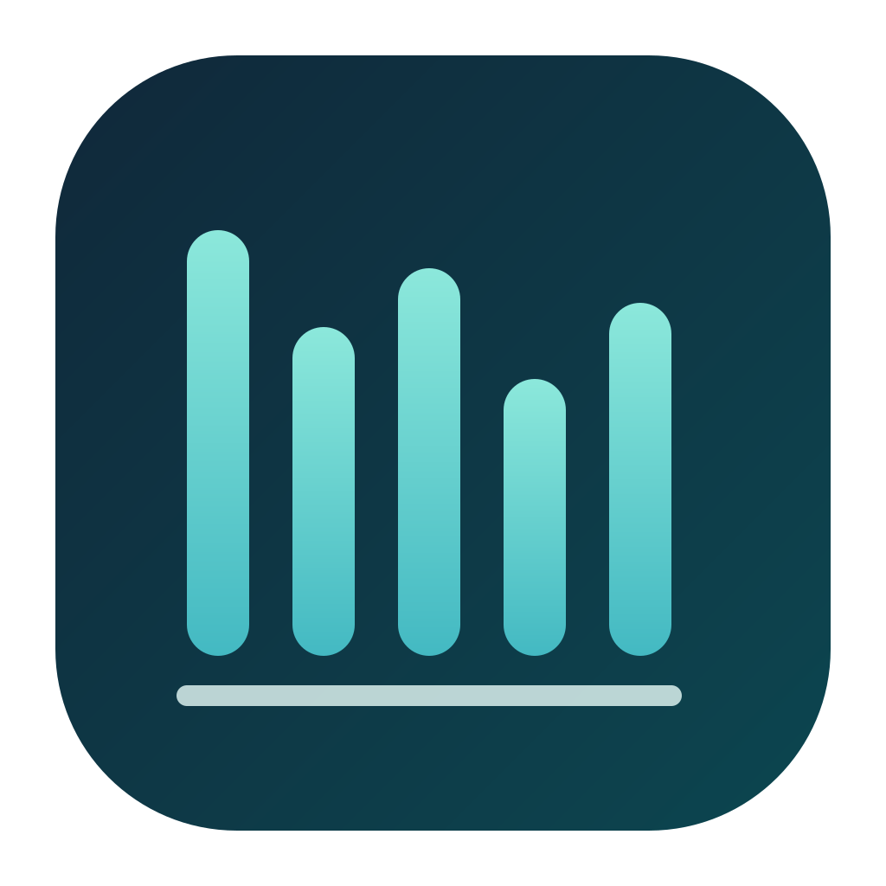
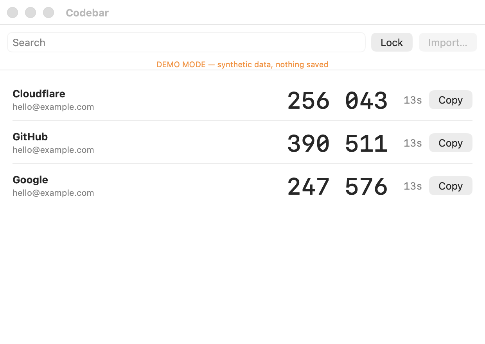

<p align="center">
  
</p>

<h1 align="center">Codebar</h1>
<p align="center">Your authenticator codes. On your Mac.</p>

<p align="center">
  
  
</p>

<p align="center">
  
</p>
<p align="center"><sub>Synthetic example data.</sub></p>

Codebar displays time-based authenticator codes on your Mac. It stores imported accounts in your local macOS login Keychain and works offline.

## Import your accounts

1. On your phone, open Google Authenticator and choose **Menu → Transfer accounts → Export accounts**.
2. Save or screenshot an export QR code. Exports with many accounts may contain several QR codes.
3. In Codebar, choose **Import… → Choose QR image…** (or paste the image).
4. Review the accounts and choose **Save to Keychain**. Repeat for each QR code.

This copies existing time-based accounts; it does not change your phone or sync future changes. **QR codes contain account secrets—keep them private and delete temporary copies when finished.**

## Build

Requirements: macOS 13 or later and Xcode Command Line Tools.

```sh
git clone https://github.com/ammarshah1n/codebar.git
cd codebar
./build.sh
open "build/Codebar.app"
```

Run the built-in self-test:

```sh
"build/Codebar.app/Contents/MacOS/Codebar" --self-test
```

No third-party dependencies or Google login. The app requests no network permission. Its lock button clears codes from view; it is not biometric authentication. Builds are ad-hoc signed and not notarized. Rebuilding can change Keychain access permissions; keep your original phone accounts.

Independent project, not affiliated with Google. [MIT license](LICENSE).
